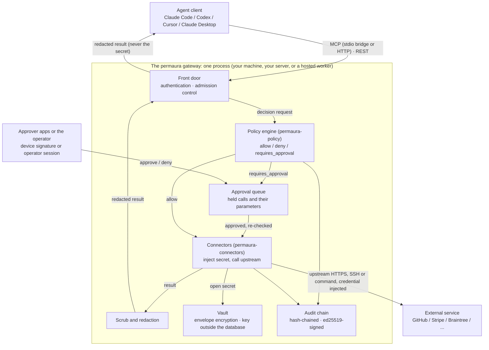

# Architecture

Permaura is one enforcement runtime, the `permaura` gateway, that runs in three places: on your own machine, on a server you run, or as a hosted worker in Permaura Cloud. Wherever it runs, the same process authenticates the caller, evaluates policy, holds the sealed vault, makes the upstream call with the credential injected, redacts the result and appends to the audit chain. This document describes the components, the enforcement loop and the deployment modes as they ship. [security.md](./security.md) describes the mechanisms in detail and [threat-model.md](./threat-model.md) what they do and do not defend against.

## The shape of the system

- **The gateway**: `permaura start`, built from the `permaura-gateway` crate in `services/gateway`. An axum service with a REST API under `/v1` and an MCP endpoint at `/mcp`, plus the operator CLI that drives it. It keeps its state in one SQLite database (`~/.permaura/gateway.db` by default) and its vault key outside that database, in the OS credential store where the platform and the build allow it and in an owner-only file otherwise. It runs with no account.
- **permaura.com**, which is proprietary and not in this repository: accounts and organizations, the web console, the OAuth authorization server that a gateway with remote access trusts, the managed tunnel names under `permaura.app`, and the provisioning of hosted workers. Policies, grants, agents, the vault and the audit chain live in each gateway's own store, not in permaura.com. The console reads and edits them through the gateway's API, relayed by permaura.com's broker when the browser cannot reach the gateway directly, and console traffic that carries a credential passes through that broker in a form it could read. The phone app reaches every gateway through the same broker, so a credential added from the phone passes through it the same way.
- **Approver apps**: the desktop app, the phone app and its Apple Watch companion. Each holds an approver signing key, shows a held call and signs the decision; a gateway trusts a key once it has been paired with it.

## Components

### Agent client

Claude Code, Codex CLI, Cursor, Claude Desktop or any MCP client. It is **untrusted**: it can propose calls and supply a reason, but it never holds a secret and never makes a policy decision. It speaks MCP, locally through the `@permaura/mcp-stdio` bridge (a stdio server that forwards each call to the gateway's `/mcp` with the agent's token) or remotely over streamable HTTP with a bearer or OAuth token, or it calls the REST API.

### The front door

The gateway authenticates the caller (a session bearer, or with remote access an OAuth access token permaura.com issued), resolves it to an agent and a session, refuses a call that admission control refuses, and hands the rest to the policy engine. The same process that terminates the connection, whether it arrived over loopback, a tunnel, a public URL or a hosted worker's load balancer, also opens the secret and makes the upstream call. There is no separate execution worker, so a gateway reachable from the internet holds plaintext in that process while a call runs.

### Policy engine (`permaura-policy`)

A deterministic decision point. Given the agent, the capability's action id, its connection, its risk tier and the policies and grants in scope, it returns `allow`, `deny` or `requires_approval` with a reason, the rung the call lands on (`auto`, `notify`, `approve` or `device_signed`), how many distinct people a `device_signed` hold needs, and the grant and policy behind the answer. Deny is the default. See [policy-language.md](./policy-language.md).

### Connectors (`permaura-connectors`)

The HTTP, GraphQL, command and SSH executors and the built-in connector families. A connector takes an allowed call and the opened credential, makes the upstream request through one egress guard, and returns the result, which the gateway scrubs and redacts before the agent sees it. Command capabilities are refused on a hosted worker.

### Vault and crypto

Each secret is one row in the `secrets` table, holding its sealed record (ciphertext, wrapped DEK, salt, nonces, cipher id) and its metadata. A fresh random DEK encrypts the value with AES-256-GCM or ChaCha20-Poly1305, and a wrapping key derived with Argon2id from the vault key and a per-secret salt wraps the DEK. The vault key lives outside the database: in the OS credential store or an owner-only file locally, and in a file mounted from Secret Manager on a hosted worker. Cloud KMS wraps the hosted audit key and any secret explicitly enrolled to it. See [security.md](./security.md).

### Audit log

Every policy decision and every execution appends a hash-chained, ed25519-signed event, and so do the configuration and trust changes [security.md](./security.md#tamper-evident-audit-chain) lists. Altering or removing an event inside the chain breaks it. Removing events from the end leaves a chain that still verifies, and on a self-run gateway the signing key is an owner-only file beside the database, so whoever can write the database can also re-sign a rewritten history: the chain is evidence against an outsider, not against whoever holds the store. A call refused before it reaches policy (an unknown capability, a session over its denial budget, agents paused by the deployment, a gateway restoring or draining, a rejected bearer, a rate limit) leaves no event; the operator's own pause is a policy-time denial and is recorded.

## Components diagram



If your renderer does not support Mermaid, the same flow as text:

```text
  Agent client (Claude / Codex / Cursor)
        │ MCP or REST, with the agent's token   (no secret travels this edge)
        ↓
  ┌──────────────────── the permaura gateway, one process ────────────────────┐
  │  front door: authenticate, admission control                              │
  │        ↓                                                                  │
  │  policy engine ── requires_approval ──▶ approval queue ◀── approver app   │
  │        │ allow                               │ approved, re-checked       │
  │        ↓                                     ↓                            │
  │  connectors: open the secret from the vault, call upstream                │
  │        ↓                                                                  │
  │  scrub and redact the result, append the terminal audit event             │
  └───────────────────────────────────────────────────────────────────────────┘
        │ redacted result
        ↓
  Agent client
```

## The enforcement loop

1. **The agent calls a tool.** For example the fixed `permaura_invoke` tool with `capability: "braintree.transactions.search"`, its parameters and a `reason`, or the capability's own tool, or `POST /v1/invoke`.
2. **The gateway identifies the agent and the session.** A bearer is looked up by its hash in the session table; an OAuth access token is verified against permaura.com's keys. An agent still waiting to be approved is refused.
3. **Admission control.** Before policy, the gateway refuses a call while an execution hold is in force after a restore, while the deployment has paused agents (`PERMAURA_AGENTS_PAUSED`), while it is draining to stop, from a session over its denial budget, for a capability it does not have, or above its size ceiling. These refusals are answered and not recorded, so that refusing a call costs less than serving one. Bearer failures and rate limits are refused earlier still.
4. **The gateway checks policy.** The engine answers `allow`, `deny` or `requires_approval`. If no live grant binds a policy that permits the action, the answer is `deny`. A denial and a hold are each recorded in the audit chain.
5. **A held call waits for a person.** It stays in the approval queue, with its parameters, until it is approved, denied or revoked. At the `approve` rung the operator's session (the console or the CLI) or a paired device resolves it; at `device_signed` only device signatures do, as many distinct people as the policy's quorum. High and Critical risk raise a call to `approve`, not further. The desktop app shows a Touch ID or Windows Hello prompt before it signs, but that prompt is in front of the signature, not part of it. When the hold is resolved, the gateway re-checks the session, the capability, the agent, the policy, the grant and its budget before anything runs. The agent polls `permaura_get_approval_status`.
6. **The gateway makes the upstream call with the injected secret.** It appends an `attempt` event first, then opens the sealed secret in memory, injects it into the outbound request and sends it through the egress guard. The agent never observes this step.
7. **The result is scrubbed, redacted and returned, and the outcome is recorded.** The credential the call injected is removed from the result by value, fields on the redaction list are replaced, and the terminal audit event records the agent, the capability, the decision, the grant and policy that authorized it, the agent's stated reason after masking, the upstream status and the shape of the result (a record or field count), never its body.

## Deployment modes

### Local only

```text
Claude Code / Codex / Cursor
        ↓  stdio bridge, or HTTP on loopback
permaura gateway (policy, vault, connectors) on your machine
        ↓
External API
```

Secrets stay on the machine and permaura.com is not required. Nothing biometric gates a decrypt: once the gateway holds its vault key it decrypts on its own authority for every allowed call, and a process running as the same OS user can read the operator token and call the API directly. [threat-model.md](./threat-model.md) says what a paired device does and does not bound there.

### Self-run with remote access

```text
Remote agent
        ↓  https://<name>.permaura.app (a managed tunnel), or your own reverse proxy
permaura gateway (policy, vault, connectors) on your machine or server
        ↓
External API
```

A remote agent reaches the same gateway through a tunnel: `permaura remote enable` reserves a `permaura.app` name and runs a Cloudflare connector as a child of the gateway, or you put the gateway behind your own reverse proxy and set `PERMAURA_PUBLIC_URL`. The gateway then accepts OAuth access tokens issued by permaura.com. Policy and execution still happen on your machine and the credential does not leave it, but that machine has to be online, its gateway is reachable from the internet, and permaura.com's authorization server and the tunnel provider's account become part of what it trusts ([security.md](./security.md#account-recovery-is-a-trust-choice)).

### Hosted worker

```text
Any agent
        ↓
Permaura hosted gateway for your tenant (Cloud Run)
        ↓
External API
```

Permaura Cloud runs the same gateway for each tenant, with its own Cloud Run service, runtime service account, store snapshot bucket, vault key in Secret Manager and Cloud KMS key. It works with no machine of yours online. The honest tradeoff: the hosted worker must be able to decrypt the secret at call time, and a compromise of that tenant's runtime reaches that tenant's secrets. Permaura does not claim zero-knowledge hosted execution. Owners who need stronger guarantees run the gateway themselves.

## Why one runtime

Building the loop three times would mean three policy engines, three redaction layers and three audit formats to keep in sync. Building it once, in the gateway and the crates it uses, means a fix or a hardening lands in every deployment at once.
